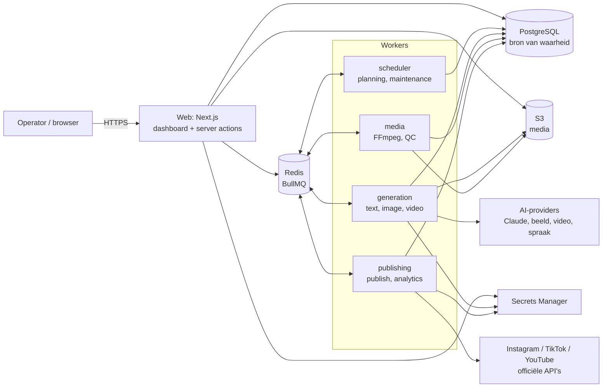
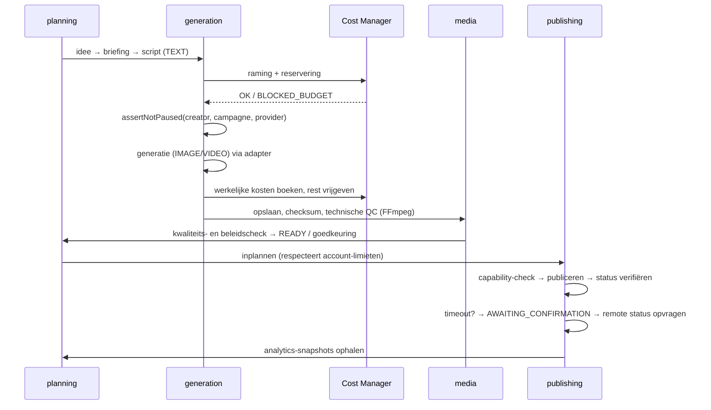

# Architectuur

AI Creator Farm is een **modulaire monolith**: één Next.js-applicatie (dashboard + API) en één worker-codebase die als vier afzonderlijk schaalbare rollen wordt gedeployed. PostgreSQL is de bron van waarheid voor alle bedrijfsstatussen; Redis/BullMQ is uitsluitend transport en planning.

## Uitgangspunten

| Principe | Uitwerking |
|---|---|
| Eenvoudigste betrouwbare oplossing | Geen microservices, geen event-bus, geen aparte API-server. Modules zijn mappen met duidelijke grenzen. |
| Database is de waarheid | Elke job heeft een rij met expliciete status. Queue-jobs dragen alleen ID's; na een herstart wordt de status uit de database gelezen. |
| Expliciete statusmachines | `src/lib/state-machines.ts` bepaalt welke overgangen legaal zijn; services roepen `assertTransition()` aan vóór elke update. Updates gebruiken compare-and-set (`WHERE status = <verwacht>`). |
| Niets gebeurt stilzwijgend | Kosten, publicaties, pauzes en rechtenwijzigingen worden geaudit in een append-only log. |
| Eerlijke data | Elk getal is *measured*, *estimated*, *demo* of *mock*, en wordt zo getoond. Een ontbrekende prijs is nooit € 0. |
| Server-side handhaving | Budgetten, limieten, rechten en pauzes worden in services/workers afgedwongen, nooit alleen in de UI. |

## Stackevaluatie

De voorgeschreven stack is behouden. Afwegingen:

| Keuze | Besluit | Reden |
|---|---|---|
| Next.js 15.5 (App Router) + TypeScript | Behouden | Server components + server actions houden de API-laag dun. 15.5 i.p.v. 16: volwassen, gepatcht (incl. de RSC-beveiligingsfixes) en compatibel met Auth.js v5. Upgrade naar 16 is een geïsoleerde taak. |
| PostgreSQL 16 + Prisma 6 | Behouden | Prisma 6 (niet 7) omdat 7 een andere client-/adapterarchitectuur vereist zonder voordeel voor deze schaal. Constraints die Prisma niet kan uitdrukken staan als SQL in de migratie. |
| Redis + BullMQ 5 | Behouden | Retries, delays, prioriteiten, job schedulers en stalled-job detectie out-of-the-box. Per-provider limieten worden in de processors afgedwongen (BullMQ-groepen zijn Pro-only). |
| S3-compatibele opslag | Behouden | Driver-abstractie: `s3` in productie, `local` voor ontwikkeling/tests. |
| Auth.js v5 (credentials, JWT) | Behouden | Kleine, bekende gebruikersgroep. Rol en `disabledAt` worden **per request** uit de database gelezen, dus intrekken werkt direct ondanks JWT. OIDC/SSO kan later als extra provider. |
| Tailwind v4 + shadcn/ui-patroon | Behouden | Componenten zijn in-repo (Radix + cva), dus volledig aanpasbaar zonder registry-afhankelijkheid. |
| Zod 4 | Behouden | Validatie van env, filters, server-actions en (fase 3) promptvariabelen. |
| FFmpeg | Behouden | Zit in het worker-image; mediawerk draait alleen in de `media`-rol. |
| OpenTelemetry | `@vercel/otel` voor web (alleen actief met `OTEL_EXPORTER_OTLP_ENDPOINT`); workers volgen in fase 10. |
| Cloud | AWS `eu-central-1` (Frankfurt) | EU-dataresidentie (AVG), beheerde RDS/ElastiCache/S3/Secrets Manager, ECS Fargate voor web + workers. Zie `deployment.md`. |

## Projectstructuur

```
creator-farm/
├── prisma/
│   ├── schema.prisma            # volledig datamodel (alle fasen)
│   ├── migrations/              # incl. handgeschreven SQL: triggers, partiële unieke indexen, checks
│   └── seed.ts                  # owner, providerregister, limieten, starterprompts, --demo
├── src/
│   ├── app/                     # Next.js routes
│   │   ├── (auth)/login/        # inloggen
│   │   ├── (dashboard)/         # 14 secties, elk een map; server actions per sectie (actions.ts)
│   │   └── api/                 # auth, health (live/ready), geauthenticeerde media
│   ├── components/
│   │   ├── ui/                  # design-system primitives (shadcn-patroon)
│   │   ├── layout/              # sidebar, filterbalk, gebruikersmenu, thema
│   │   └── dashboard/           # status-/herkomstbadges, statkaarten, lege staten
│   ├── config/navigation.ts     # secties, groepen, iconen, fase
│   ├── lib/                     # framework-vrij: statusmachines, RBAC, geld, backoff, filters
│   ├── server/                  # alleen server-side
│   │   ├── auth/                # Auth.js-config, credential-check, sessiehulpen
│   │   ├── queue/               # queue-topologie, enqueue, worker-factory, heartbeats
│   │   ├── providers/           # catalogus + adaptercontract (types.ts); adapters in fase 4/6
│   │   ├── services/            # domeinservices (users, dashboard; later creators, content, costs…)
│   │   ├── actions.ts           # wrapper: auth → permissie → validatie → veilige fouten
│   │   ├── audit.ts controls.ts env.ts secrets.ts storage.ts crypto.ts logger.ts health.ts
│   ├── workers/
│   │   ├── main.ts              # worker-entrypoint, rol via WORKER_QUEUES
│   │   └── processors/          # per queue; fase 1: maintenance
│   ├── instrumentation.ts       # OpenTelemetry (optioneel)
│   └── middleware.ts            # route-bescherming
├── tests/unit, tests/integration, e2e/
├── infra/aws/                   # ECS task-definities, autoscaling
├── Dockerfile                   # targets: web, worker, migrate
├── docker-compose.yml           # volledige lokale stack incl. MinIO
└── .github/workflows/           # ci.yml, release.yml
```

Toekomstige modules volgen hetzelfde patroon: `src/server/services/<module>.ts` (domeinlogica, transacties, audit) + `src/app/(dashboard)/<sectie>/` (UI + server actions) + `src/workers/processors/<queue>.ts`.

## Componentoverzicht



## Content-pipeline (fase 5–9)

Elke stap is een **afzonderlijke job** met eigen idempotency key `<contentItemId>:<stap>:<poging>`. Een mislukte stap wordt hervat vanaf die stap; een mislukte publicatie leidt nooit tot een nieuwe generatie.



## Queue-architectuur

Gedefinieerd in `src/server/queue/definitions.ts`; zichtbaar in de Workflow Monitor.

| Queue | Rol | Concurrency | Pogingen | Timeout | Doel |
|---|---|---|---|---|---|
| `planning` | scheduler | 2 | 3 | 5 m | ideeën, kalender vullen |
| `generation-text` | generation | 10 | 3 | 3 m | LLM-calls |
| `generation-image` | generation | 5 | 3 | 10 m | beeldgeneratie |
| `generation-video` | generation | 2 | 2 | 45 m | video, spraak, lip-sync (pollend) |
| `media-processing` | media | 2 | 3 | 20 m | FFmpeg, ondertitels, technische QC |
| `publishing` | publishing | 3 | 4 | 10 m | publiceren met statusverificatie |
| `analytics` | publishing | 2 | 3 | 5 m | statistieken ophalen |
| `maintenance` | scheduler | 1 | 3 | 2 m | reserveringen vrijgeven, vastgelopen jobs |
| `dead-letter` | — | — | — | — | uitgeputte jobs, alleen handmatig opnieuw |

Mechanismen:

- **Idempotente enqueue** — `enqueue()` leidt de BullMQ-job-ID af van een zakelijke idempotency key; dezelfde stap kan niet dubbel in de queue staan.
- **Backoff** — exponentieel met *full jitter* (`src/lib/backoff.ts`), per queue een basis en plafond.
- **Timeouts** — elke poging krijgt een `AbortSignal`; overschrijding geeft `JobTimeoutError`.
- **Dead-letter** — na de laatste poging (of bij `UnrecoverableError`) wordt een kopie met reden in `dead-letter` gezet.
- **Vastgelopen jobs** — BullMQ-stalled-detectie (30 s) plus `jobs.detect-stuck` (elke 2 min) die DB-jobs voorbij `stuckAfterMs` corrigeert. Publicaties gaan dan naar `AWAITING_CONFIRMATION`, nooit direct opnieuw.
- **Prioriteiten** — publicaties (2) gaan voor generatie (5) en analytics (8).
- **Limieten per provider/account** (fase 4/7) — Redis-token-bucket in de processor; bij overschrijding wordt de job vertraagd (`DelayedError`), niet gefaald.
- **Heartbeats** — elke worker schrijft elke 15 s; de monitor toont levende consumers per queue.
- **Graceful shutdown** — `SIGTERM` laat actieve jobs afmaken (ECS `stopTimeout: 120`).

## Kostenbeheersing (Cost Manager, fase 5/8)

1. **Raming** — `adapter.estimateCost()` geeft een conservatieve bovengrens. Geen prijs (`null`) ⇒ job `BLOCKED_POLICY`, nooit € 0.
2. **Reservering** — in één transactie met `SELECT … FOR UPDATE` op de budgetregels: som(geboekt + gereserveerd + raming) ≤ limiet voor *alle* toepasselijke budgetten (globaal dag/maand, creator, campagne, provider) én ≤ `maxCostPerJob`. Anders `BLOCKED_BUDGET` + melding.
3. **Uitvoering** — alleen met een `HELD`-reservering.
4. **Afrekening** — werkelijke kosten (`PROVIDER_REPORTED`/`MEASURED`, of `ESTIMATED` met onzekerheidsnotitie) als `CHARGE` in het append-only `cost_ledger`; reservering → `CONSUMED`. Correcties alleen via `ADJUSTMENT`-boekingen.
5. **Opruimen** — verlopen reserveringen worden door `maintenance` vrijgegeven.
6. **Automatisch pauzeren** — bij het bereiken van een harde limiet met `autoPause` zet het systeem een `control_switch`; hervatten vereist een admin, verhogen vereist een owner-goedkeuring.

Mock-kosten (`is_mock`) worden apart getoond en tellen nooit mee als uitgave.

## Autonomie (fase 8)

Standaardmodus `CONTROLLED_AUTONOMY`. Het systeem mag binnen `autonomy_policies` en `budget_policies` zelfstandig plannen, genereren, selecteren, inplannen en publiceren. Er bestaat **geen schrijfpad** van agents naar beleidsregels: die zijn alleen via server actions met `policies:manage`/`budgets:raise` (owner) te wijzigen, en een verhoging loopt via een `approvals`-record. Kill switches bestaan per creator, campagne, provider en voor de hele generatie- of publicatieketen.

## Schaalbaarheid

Ontworpen voor 10–50 creators (orde 50–300 contentitems/dag). Knelpunten en de route daarna:

- **Generatie** — schaalt horizontaal per worker-rol op queue-diepte.
- **Database** — alle hot-path queries zijn geïndexeerd op `(status, updated_at)`, `(creator_id, …)`; ledger-aggregaties per periode. Voorbij ~200 creators: leesreplica voor dashboards, maandpartitionering van `cost_ledger` en `analytics_snapshots`.
- **Redis** — `noeviction` + AOF; BullMQ-data wordt na 7/30 dagen opgeruimd.
- **Modules** — de worker-rollen kunnen zonder codewijziging naar aparte services; de webmonoliet kan modules afsplitsen langs `src/server/services/*`.
