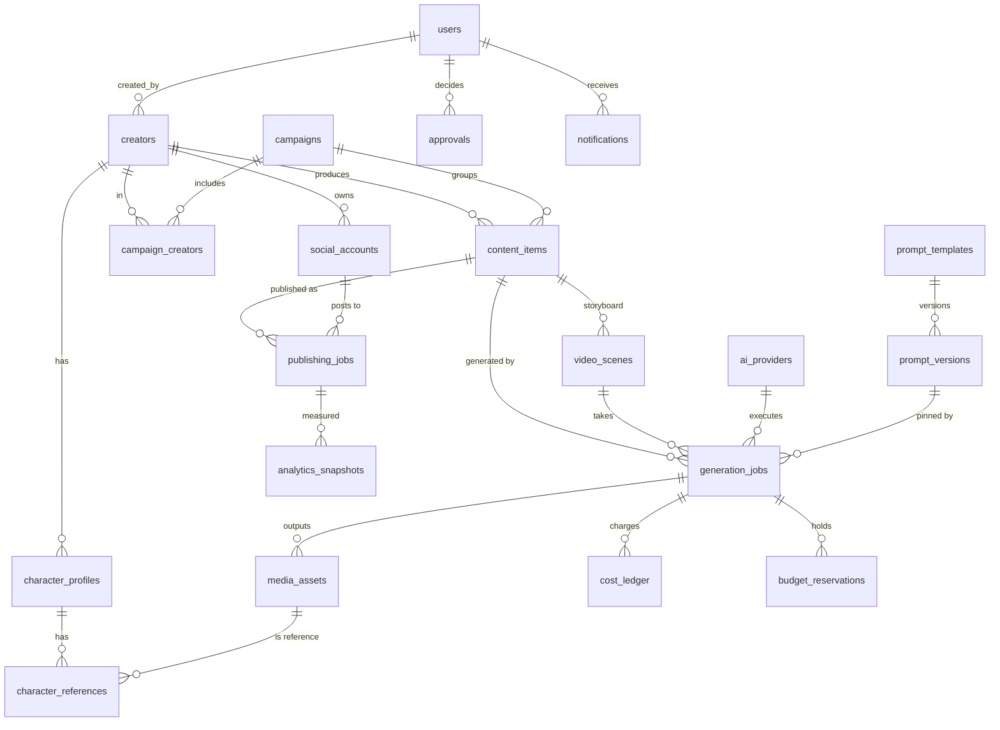

# Datamodel

Bron: `prisma/schema.prisma` en `prisma/migrations/*/migration.sql`. Alle 17 vereiste entiteiten zijn aanwezig, plus de ondersteunende tabellen die kostenbeheersing en autonomie nodig hebben.

## Conventies

- **Sleutels** — UUID (`@db.Uuid`), gegenereerd door de applicatie.
- **Tijd** — `timestamptz(3)`, altijd UTC. Weergave per creator-tijdzone gebeurt in de UI.
- **Namen** — `snake_case` tabellen/kolommen, `camelCase` in TypeScript.
- **Geld** — `BigInt` micro-eenheden (1 EUR = 1.000.000) + `currency CHAR(3)`. Geen floats, en `NULL` betekent *onbekend*, nooit nul.
- **Bestanden** — nooit in PostgreSQL. `media_assets` bewaart `storage_key`, `checksum_sha256` (gevalideerd `^[0-9a-f]{64}$`), grootte, afmetingen en herkomst.
- **Secrets** — nooit in tabellen. Kolommen `credential_ref` bevatten een verwijzing zoals `env:ANTHROPIC_API_KEY` of `aws-sm:creatorfarm/prod/social/<id>`.
- **Herkomst** — `is_demo` (seed-demonstratie) en `is_mock` (mockprovider) op alle tabellen waar resultaten kunnen ontstaan; analytics hebben `origin` = `MEASURED` | `DEMO` plus `source`.

## Entiteiten

| Tabel | Doel | Belangrijke regels |
|---|---|---|
| `users` | Operators met rol `OWNER/ADMIN/OPERATOR/VIEWER` | e-mail uniek (lowercase), bcrypt-hash, `disabled_at` |
| `creators` | Virtuele creator: niche, doelgroep, taal, regio's, persoonlijkheid, fictief verhaal, pijlers, formats, promptinstellingen, schema, tijdzone, autonomiemodus | `slug` uniek; status-machine `DRAFT→ACTIVE⇄PAUSED→ARCHIVED` |
| `character_profiles` | Geversioneerde visuele identiteit: uiterlijk (JSON), identiteitsprompt, negatieve prompt, consistentiestrategie, likeness-attestatie | `(creator_id, version)` uniek; **max. één `APPROVED` per creator** (partiële index) |
| `character_references` | Canonieke referentiebeelden per profielversie | koppelt naar `media_assets` met `RESTRICT` |
| `social_accounts` | Platformaccount per creator: scopes, geverifieerde capabilities, tokenverloop, posts/dag-limiet | `(platform, external_account_id)` en `(platform, handle)` uniek; alleen `credential_ref` |
| `prompt_templates` | Template per soort (`IMAGE`, `VIDEO`, `SCRIPT`, `CAPTION`, …) en scope (globaal/creator/campagne) | `key` uniek |
| `prompt_versions` | Onveranderlijke gepubliceerde versies + variabelenschema + standaardparameters | `(template_id, version)` uniek; jobs verwijzen naar de versie-ID |
| `ai_providers` | Providerregister: capabilities, status (`NOT_CONFIGURED/ACTIVE/DEGRADED/DISABLED`), mock-vlag, prijstabel, prioriteit | lege prijstabel ⇒ betaald gebruik geblokkeerd |
| `campaigns` + `campaign_creators` | Campagnes over meerdere creators | n:m |
| `content_items` | Eén publiceerbaar stuk content door de pipeline | status-machine; `generation_count ≤ max_generations` (check) |
| `video_scenes` | Storyboard: volgorde, prompt, actie, duur, dialoog, audio, referentie, goedgekeurde take | `(content_item_id, position)` uniek; duur > 0 |
| `generation_jobs` | Eén generatiepoging: provider, promptversie, gerenderde prompt, parameters, provider-job-ID, pogingen, geraamde/werkelijke kosten, fout | `idempotency_key` uniek; pogingen 1–10 |
| `media_assets` | Opgeslagen bestand + volledige herkomst (prompt, provider, modelversie, parameters, kwaliteit, rechten) | `storage_key` uniek; checksum-formaat |
| `approvals` | Menselijke beslissingen: content, media, karakter, promptversie, accountkoppeling, budgetverhoging, securitywijziging | `payload` bevat het voorstel |
| `publishing_jobs` | Eén publicatie van een item op een account | `idempotency_key` uniek; **max. één niet-geannuleerde job per item+account**; `(platform, external_post_id)` uniek |
| `cost_ledger` | **Append-only** kostenjournaal | trigger blokkeert UPDATE/DELETE/TRUNCATE; `idempotency_key` uniek; `ESTIMATED` vereist `uncertainty_note`; `CHARGE ≥ 0` |
| `budget_reservations` | Gereserveerd budget per job (`HELD→CONSUMED/RELEASED`) | bedrag > 0; `expires_at` |
| `budget_policies` | Harde limieten per scope (globaal/creator/campagne/provider) en periode (dag/maand) | uniek per scope+target+periode; target verplicht behalve bij globaal |
| `autonomy_policies` | Kosten per job, generaties per item, gelijktijdige jobs, posts/dag, workflowduur, retries, verplichte goedkeuring | uniek per scope+target |
| `control_switches` | Kill switches (`ALL_GENERATION`, `ALL_PUBLISHING`, `CREATOR`, `CAMPAIGN`, `PROVIDER`) | uniek per scope+target |
| `analytics_snapshots` | Tijdgestempelde meting met bron en ruwe respons | per account/item/tijd geïndexeerd |
| `audit_logs` | **Append-only** audittrail: actor (user/system/agent), actie, entiteit, metadata, IP, user agent | trigger blokkeert UPDATE/DELETE/TRUNCATE; secrets worden vóór opslag geschrapt |
| `notifications` | Meldingen aan een gebruiker of iedereen | — |

## Relaties

`cost_ledger` gebruikt `ON DELETE RESTRICT` naar alle gerelateerde entiteiten: zolang er kosten aan hangen, kan een creator, campagne of job niet worden verwijderd (archiveren kan wel).

## JSON-velden (gevalideerd met Zod, `src/lib/schemas/creator.ts`)

| Veld | Vorm |
|---|---|
| `creators.content_pillars` | `[{ name, description }]`, 1–8 |
| `creators.publishing_schedule` | `{ slots: [{ platform, weekday (1 = ma), time "HH:MM" }] }`, uniek per slot, in `creators.timezone` |
| `character_profiles.appearance` | `{ ageRange, build, skinTone, hair, eyes, face, distinguishingFeatures, wardrobe }` |
| `character_profiles.consistency_strategy` | `{ referenceWeight 0–1, seed | null, notes }` |

`jsonb` bewaart sleutels niet in invoervolgorde; wijzigingsdetectie gebruikt daarom een sleutelvolgorde-onafhankelijke vergelijking.

## Statusmachines

Gedefinieerd in `src/lib/state-machines.ts` en volledig getest. Kernregels:

- **Content** — vooruit door de pipeline; `FAILED` kan hervat worden bij de mislukte stap (`PROMPTED`, `GENERATING`, `APPROVED` of `SCHEDULED`). Een mislukte publicatie gaat terug naar `SCHEDULED`, niet naar generatie.
- **Publicatie** — `PUBLISHING → AWAITING_CONFIRMATION` bij timeout; vanuit daar alleen `PUBLISHED`, `FAILED` of `NEEDS_MANUAL_ACTION` na remote verificatie. Nooit direct terug naar `PUBLISHING`.
- **Generatiejob** — `FAILED → QUEUED` (retry) of `DEAD_LETTER`; `BLOCKED_BUDGET/POLICY → QUEUED` na vrijgave.
- **Karakterprofiel** — `DRAFT → APPROVED → SUPERSEDED`; een nieuwe versie goedkeuren zet de vorige op `SUPERSEDED` (in één transactie, afgedwongen door de partiële unieke index).

## Onveranderlijkheid van goedgekeurde content

- Gepubliceerde `prompt_versions` worden nooit gewijzigd; bewerken maakt een nieuwe versie.
- `generation_jobs` slaan `prompt_version_id`, de **gerenderde** prompt en de **werkelijk toegepaste** parameters op.
- `media_assets` bewaren een eigen `prompt_snapshot` en `params_snapshot`, dus ook na archiveren van templates blijft herkomst reproduceerbaar.
- Actieve campagnes pinnen promptversies; een template-update raakt ze pas na een expliciete wijziging.

## Retentie

| Data | Bewaartermijn (voorstel) |
|---|---|
| `audit_logs`, `cost_ledger` | 7 jaar (fiscale bewaarplicht); daarna archiveren naar S3 Glacier |
| `analytics_snapshots` | 2 jaar gedetailleerd, daarna maandaggregaten |
| BullMQ voltooide/mislukte jobs | 7 / 30 dagen (Redis) |
| Afgekeurde media | 90 dagen, daarna verwijderen uit opslag (S3 lifecycle) |
